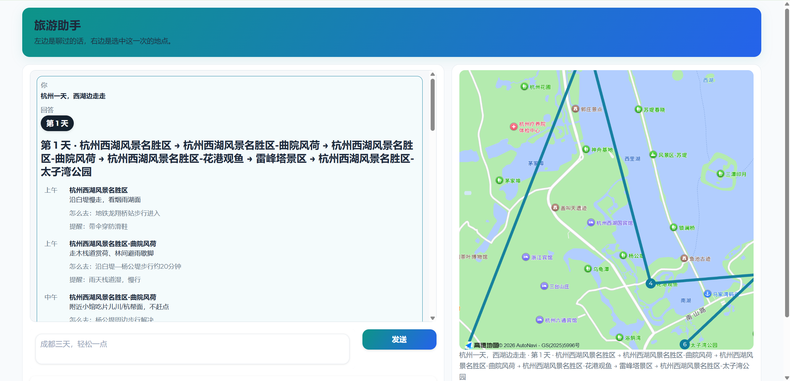
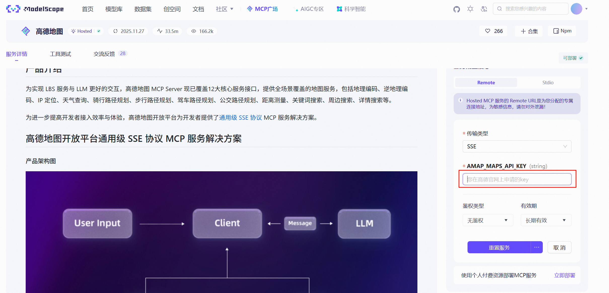

# 旅游助手 · Travel Agent

一句话出几天行程，地图按天标点连线。基于 LangChain 1.x、通义千问 Qwen 和高德地图 MCP。


[](LICENSE)



## 亮点

- **说一句话，出几天行程。** 比如「成都三天，轻松一点」，左边按天列出每一站、怎么去、要注意什么；右边地图只画选中的那一天，从第一站连到最后一站。
- **每次提问只调用一轮工具。** 模型只搜一次地点、查一次天气，其余高德工具不交给模型；地点坐标由页面补查，最多 12 次。花费和速度都可控。
- **查不到就说查不到。** 高德调用失败时，模型收到的是「没查到」，并被要求在回答里写明；高德连不上时页面补查第一次失败就停，不会卡住。

## 三步跑起来

```bash
git clone https://github.com/SWUSTcyt/langchain-travel-agent.git
cd langchain-travel-agent
pip install -r requirements.txt   # 建议 Python 3.11，并使用虚拟环境
```

1. 复制 `.env.example` 为 `.env`，按下面的「环境配置」填好 key。
2. 运行 `python main.py`。
3. 打开 http://127.0.0.1:7862/ ，点聊天框里的示例，或者直接输入城市和天数。

## 怎么用

- 左边是聊天记录，提问框在聊天框下面。还没提问时，框里有三张示例；问过之后，示例留在聊天框最下面，点一下只填进输入框，不直接发送。
- 每次行程回答是一张卡片。点哪张卡、哪一天，右边地图就画哪一天：有两个以上地点就连线，只有一个地点就只标点。序号是当天的颜色，点一下才看到地点全名。
- 只问天气这类不带行程的问题，地图保持上一张行程。
- 「清空对话」回到中国范围的空地图。

## 环境配置

本项目通过以下环境变量进行配置（可参考仓库中的 `.env.example`）：

- `DASHSCOPE_API_KEY`：
  - 用于访问 **通义千问 Qwen 模型**（通过 DashScope 平台）
  - 获取方式：登录阿里云通义千问 / DashScope 控制台，创建 API Key，将值填入 `.env` 中的 `DASHSCOPE_API_KEY`
  - 当前模型：`qwen3.8-flash`（兼容接口）。`qwen-turbo` 已下线，不要再改回 `qwen-turbo-latest`

- `AMAP_MCP_URL`：
  - 用于连接 **高德地图 MCP Server（amap-maps）** 的 SSE 服务地址
  - 获取方式（示例流程）：
    1. 打开 ModelScope（魔搭社区），进入 **MCP 广场**
    2. 搜索「高德」或「amap」相关 MCP，按照页面说明填写对应的高德api，获取url

      

    3. 在文档中找到提供的 **SSE 访问地址**（通常是以 `http://.../sse` 或 `https://.../sse` 结尾的 URL）
    4. 将该地址填入 `.env` 中的 `AMAP_MCP_URL`

- `AMAP_JS_KEY`、`AMAP_JS_SECURITY_CODE`：
  - 用于右边的 **高德地图**（Web 端 JS API），和上面的 MCP 地址不是同一个 key
  - 获取方式：登录 [高德开放平台控制台](https://console.amap.com/dev/key/app)，在应用管理里添加 Key，服务平台选「Web端(JS API)」；Key 填 `AMAP_JS_KEY`，旁边的安全密钥填 `AMAP_JS_SECURITY_CODE`（[步骤说明](https://lbs.amap.com/api/javascript-api-v2/prerequisites)）
  - 不填时页面只显示文字，地图区写「地图暂不可用」
  - 安全密钥会写进页面，只适合本地演示；公开部署请按高德文档改成代理转发

## 工作原理

1. 中间件从你的话里提取城市和天数，固定到每次地图工具调用的 `city` 参数上；追问时沿用上一轮的城市。
2. 模型在一轮里调用 `maps_text_search`（地点）和 `maps_weather`（天气），各最多一次；`maps_geo`、`maps_search_detail`、`maps_direction_*` 等工具被中间件拦下。
3. 模型写出行程，并在末尾附一段 JSON（每天的站点）。页面读出这段 JSON，按地点名对上搜索结果；对不上的，由页面补搜一次，再用 `maps_search_detail` 查坐标，按天轮流，最多 12 次。
4. 左边渲染行程卡片，右边用高德 JS API 按天画点和线。

## 开发者

### 测试

```bash
python -m unittest discover -s tests
```

### 思考过程与日志

页面下方的「开发者」折叠里有：

- AI 思考过程（`enable_thinking=True`，从 `reasoning_content` 逐块累积）
- 摘要日志（工具调用、模型调用、城市解析）
- 原始事件 JSON（勾选开发者模式后显示）

### Claude Skills

项目包含两个 Claude Skills（位于 `.claude/skills/`）：

- **understand**：分析项目架构、Agent 配置及 MCP 集成，生成 `docs/ARCHITECTURE.md`。在 Claude Code 中运行 `/understand`。
- **feature**：基于架构规范实现新功能或修复问题。在 Claude Code 中运行 `/feature`。

### 项目结构

```
├── main.py                      # 应用启动入口
├── config.py                    # 配置管理与常量定义
├── agent.py                     # Agent 创建与配置
├── tools.py                     # MCP 工具加载与异步包装
├── middleware.py                # LangChain 中间件：城市固定、工具次数控制
├── ui.py                        # Gradio 页面：左边聊天，右边地图
├── itinerary.py                 # 从回答里读出行程，并补地点坐标
├── itinerary_view.py            # 行程卡片 HTML 与地图数据
├── assets/
│   ├── custom.css               # 页面样式
│   └── trip-map.js              # 高德地图绘制（按天标点、连线）
├── tests/                       # 单元测试
├── examples/                    # 使用示例
├── requirements.txt             # 依赖清单
├── .env.example                 # 环境变量模板
├── docs/
│   ├── ARCHITECTURE.md          # 详细架构文档
│   └── images/ui-preview.png    # README 界面截图
└── src/
    └── amap-mcp-config.png      # 配置说明图
```

### 技术栈

开发时验证过的版本：

| 组件 | 版本 | 用途 |
|-----|------|------|
| Python | 3.11 | 运行环境 |
| langchain | 1.1.0 | Agent 与中间件 |
| langchain-openai | 1.3.2 | 通过兼容接口调用通义千问 |
| langchain-mcp-adapters | 0.1.14 | 接入高德地图 MCP |
| gradio | 6.0.1 | 页面 |
| 高德 JS API | 2.0 | 右边的地图 |

## 贡献

欢迎提 Issue 和 PR。改代码前建议先读 `docs/ARCHITECTURE.md`，提交前运行测试。

## 许可证

[MIT](LICENSE)
